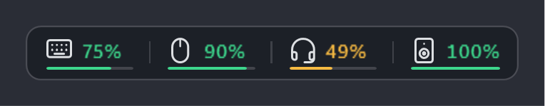
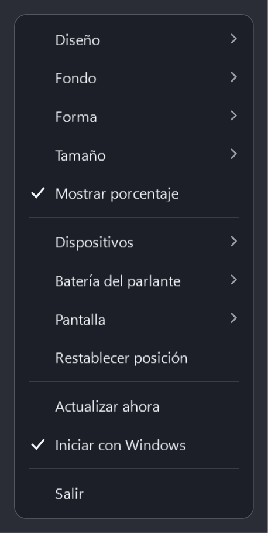

# Battery Widget

**The battery level of all your wireless devices, live on the Windows taskbar.**
Keyboard, mouse, headset, gamepad, Bluetooth gear — each one shown on its own, only while it is connected, in green / amber / red.



- **Automatic.** Detects your devices by itself; nothing to configure. Appears when a device connects, disappears when it doesn't.
- **Quiet.** ~12 MB of RAM, ~0% CPU, no network access. Everything is read locally.
- **Starts with Windows** (turned on by the installer).
- **Tidy.** Hover for details, drag to move it along the taskbar, double-click to resize, right-click for styles. It never covers your taskbar buttons, follows a second monitor if you have one, and hides while a game runs full screen.
- English and Spanish (follows your Windows language).

## Install

1. Download **`BatteryWidget-Setup.exe`** from the [latest release](../../releases/latest) and run it.
2. That's it: it installs for your user (no admin rights), starts the widget and enables *start with Windows*.

> Windows SmartScreen may say the app is from an "unknown publisher", because the installer is not code-signed. Choose **More info → Run anyway**.
> A portable `BatteryWidget-portable.zip` is also available (it turns on *start with Windows* the first time it runs; untick it in the right-click menu if you don't want that).

**Uninstall:** Settings → Apps → Installed apps → *Battery Widget*.
Requires Windows 10/11 (uses the .NET Framework 4.8 that ships with Windows).

## Supported devices

| Brand | Devices | How the battery is read | Status |
|---|---|---|---|
| **Logitech** | G / MX / LIGHTSPEED keyboards, mice, headsets | [G HUB](https://www.logitechg.com/innovation/g-hub.html)'s local service; without G HUB, **HID++ 2.0** straight from Unifying / Bolt / LIGHTSPEED receivers | ✅ tested (G915 X, G305) |
| **HyperX** | Cloud II Wireless (both dongles), Cloud Alpha Wireless, Cloud Flight | USB receiver (HID) | ✅ Cloud II tested · ⚠️ others from public protocols |
| **Corsair** | VOID / HS-series wireless headsets (USB dongle) | USB receiver (HID) | ⚠️ from public protocols, untested |
| **Razer** | wireless mice, keyboards, headsets with a USB dongle (Viper, DeathAdder, Basilisk, Naga, Cobra, BlackWidow…) | Razer Chroma feature-report protocol, auto-detected (no model list) | ⚠️ from public protocols, untested |
| **GameSir** | Nova 2 family on the 2.4 GHz dongle | USB dongle (HID) | ✅ tested |
| **ASUS (ROG), Redragon and any other brand** | anything that connects by **Bluetooth** and reports battery (classic or Bluetooth LE) | Windows' own Bluetooth data | ✅ generic |
| **Xbox-style pads** | wireless XInput controllers | XInput | ✅ generic |

⚠️ = implemented from the open-source protocol documentation but not yet confirmed on real hardware. If one works (or doesn't) for you, please open an issue — that's how it becomes ✅.

Wired devices are not shown (there is no battery to show). ASUS/Redragon products on their *proprietary 2.4 GHz dongles* use private protocols that aren't documented anywhere public; they work today when connected over Bluetooth. Not on the list? See [Contributing](#contributing) — adding a device is one small class.

### A Bluetooth speaker that doesn't report its battery

Some speakers/soundbars never send their battery level. You can still pin them: edit `%APPDATA%\BatteryWidget\config.json` and add the device name to `PinnedBluetooth`, e.g. `"PinnedBluetooth": ["My Speaker"]`. The widget then shows an **estimate** (marked "estimated") based on connection time, volume and whether audio is playing. Right-click → *Speaker battery* lets you mark it as charged or correct the level, and it learns the real battery life.

## Using it

| | |
|---|---|
| Hover | name, level and connection of that device |
| Drag | move it along the taskbar (it stops before your taskbar buttons) |
| Double-click | quick size control |
| Right-click | style, background, shape, size, screen, hide devices, start with Windows, exit |



Colors: **green** above 60 %, **amber** 25–60 %, **red** below 25 %.
Settings live in `%APPDATA%\BatteryWidget\config.json`.

## Privacy

The widget makes **no network connections**. It talks to Logitech G HUB on `127.0.0.1`, to USB receivers over HID, and to Windows. It collects and sends nothing.

## Build from source

Needs only Windows (the C# compiler that comes with .NET Framework 4.8 — no SDK, no Visual Studio).

```powershell
.\build.ps1            # dist\BatteryWidget.exe
.\build-release.ps1    # + installer and portable zip in dist\
```

Run with `--debug` to write `%APPDATA%\BatteryWidget\debug.log`, or `--always-visible` to keep it visible during full-screen apps.

Releases are built by GitHub Actions: push a tag like `v1.0.1` and the installer is attached to the release.

## Contributing

Issues and pull requests are welcome. Each device family is an `ISource` in [`src/Sources.cs`](src/Sources.cs) that returns the list of *connected* devices with a battery percentage (return `null` when a read fails, so the last value is kept briefly). Register it in [`src/Program.cs`](src/Program.cs). If you have a device that isn't supported, open an issue with the device name and, if you can, its USB `VID:PID`.

## Disclaimer

Independent project, not affiliated with or endorsed by Logitech, HyperX, GameSir or Microsoft. Product names are trademarks of their owners. The Logitech reading uses G HUB's local interface, and the HyperX/GameSir readings use the same device messages their own apps use; they may stop working if a vendor changes its firmware. Provided "as is" under the [MIT license](LICENSE).

---

## Español

**La batería de todos tus dispositivos inalámbricos, en vivo en la barra de tareas de Windows.** Teclado, mouse, auriculares, joystick, dispositivos Bluetooth: cada uno por separado, solo mientras está conectado, en verde / amarillo / rojo.

**Instalar:** descargá `BatteryWidget-Setup.exe` desde la [última versión](../../releases/latest) y ejecutalo. Se instala solo para tu usuario (sin permisos de administrador), arranca el widget y activa el inicio automático con Windows. Windows puede avisar de "editor desconocido" porque el instalador no está firmado: *Más información → Ejecutar de todas formas*.

**Desinstalar:** Configuración → Aplicaciones → Aplicaciones instaladas → *Battery Widget*.

**Uso:** pasá el mouse para ver el detalle, arrastralo para moverlo por la barra, doble clic para cambiar el tamaño y clic derecho para estilos y opciones.

**Dispositivos:** Logitech (con G HUB abierto), HyperX Cloud II Wireless, joysticks GameSir 2,4 GHz, dispositivos Bluetooth que informan batería y joysticks inalámbricos tipo Xbox. Si un parlante Bluetooth no informa su batería, agregá su nombre a `PinnedBluetooth` en `%APPDATA%\BatteryWidget\config.json` y mostrará una estimación.

**Privacidad:** no usa internet; todo se lee en tu propia PC.

## Credits

Device protocols are based on the open-source documentation of [HeadsetControl](https://github.com/Sapd/HeadsetControl), [OpenRazer](https://openrazer.github.io/), [Solaar](https://github.com/pwr-Solaar/Solaar) (Logitech HID++) and [PadSquire](https://github.com/Magniswerfer/padsquire). Line icons are drawn in the style of [Lucide](https://lucide.dev) (ISC).
